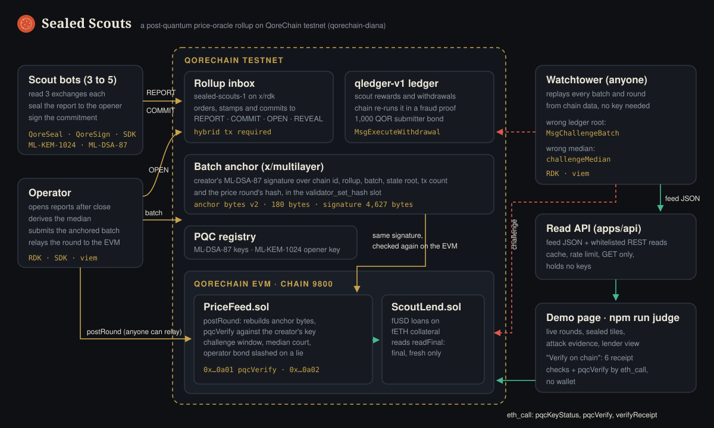

# Sealed Scouts

**Prices that a quantum attacker can't forge and a lazy reporter can't copy.**

Sealed Scouts is a post-quantum price-oracle rollup for [QoreChain](https://qorechain.io), built for the
Build Before Q-Day fest (Protocol Builders track).

QoreChain has no price oracle yet, so no lending, stablecoin or DCA app on it can read a fair price. Oracles are
also the best Q-Day target: whoever forges the reporters' signatures can drain every app that trusts the feed.

**Live demo:** [sealed-scouts.tailcdec7a.ts.net](https://sealed-scouts.tailcdec7a.ts.net) (QoreChain testnet). Its
Verify tab checks any rollup's settlement receipt on chain, with no wallet. Until our rollup is live, the rounds shown
are a labelled sample.



## How it works

1. **Bonded scouts** report prices each round: fETH, fBTC and fUSD, each from three public exchange APIs.
2. **Sealed reports.** Each report is sealed with ML-KEM-1024 (QoreSeal) to the opener's registered key, and its
   salted commitment is signed with ML-DSA-87. Until the round closes, a report is only ciphertext, so scouts can't
   copy each other.
3. **Rollup.** The reports go into the inbox of the rollup `sealed-scouts-1` on QoreChain's own rollup module. After
   close the operator opens every report, and everyone can derive the same median from the same inbox data.
4. **Signed batches.** Every batch is a hybrid transaction and carries the creator's ML-DSA-87 anchor signature. The
   price round's hash rides inside that signed anchor.
5. **Verified on chain.** `PriceFeed.sol` on the QoreChain EVM rebuilds the anchor bytes and checks the same signature
   with the `pqcVerify` precompile, using the key it reads from `pqcKeyStatus`. A new price is pending until its
   challenge window ends.
6. **Watchtower.** An independent watcher replays every round and batch from chain data. A wrong median is challenged
   in the feed contract, which recomputes it and slashes the operator's bond. A wrong ledger root is challenged with
   the chain's own fraud proof.
7. **Withdrawals.** Scouts are paid on the rollup ledger and withdraw to QoreChain with a Merkle proof.
8. **Consumer.** `ScoutLend.sol`, a small demo lender, reads only final, fresh prices.

More detail: [docs/ARCHITECTURE.md](docs/ARCHITECTURE.md). Message formats and interfaces: [docs/SPEC.md](docs/SPEC.md).

## Check it yourself, with no key

You need Node 22. Nothing below needs an account, a wallet or a private key.

```bash
git clone https://github.com/AaroneGeorge/Sealed-Scouts && cd Sealed-Scouts
npm ci
npm run judge
```

`npm run judge` reads the rollup from the public testnet, builds the latest batch's settlement receipt, runs the six
receipt checks, shows that a copy with one changed digit is refused, verifies the same ML-DSA-87 anchor signature
through `pqcVerify` on the EVM, and checks that the creator signed the latest price round. For that last part it
replays the recent rounds itself with the watchtower, so it does not rely on our servers; if that replay cannot
finish, it says so and names the published feed it read instead. It prints PASS, FAIL or SKIP per check and is
built to finish in under two minutes (the local replay is capped at 90 s). While a part is not live yet it says
SKIP, never PASS.

The same receipt checks run on any rollup: `npm run judge -- --rollup vigil-1`.

To check a receipt with the RDK's own tool instead of our code:

```bash
npm run receipt -- --out receipt.json        # also writes receipt.tampered.json
npx @qorechain/rdk-cli@0.9.0 receipt verify receipt.json            # 6 of 6 PASS
npx @qorechain/rdk-cli@0.9.0 receipt verify receipt.tampered.json   # fails
```

The demo page does the same in your browser. Open its **Verify** tab and press **Verify on chain**: the page reads
the batch and its anchor, rebuilds the signed bytes, and calls `pqcVerify` with a plain `eth_call`. Tick
"Change one digit first" to watch the same signature fail.

Every claim in this README has a transaction or a repeatable read in [PROOF.md](PROOF.md).

## Fest requirements

| Requirement | Where |
|---|---|
| Rollup or sidechain | Rollup `sealed-scouts-1` on QoreChain's `x/rdk` module ([PROOF.md](PROOF.md) row 1) |
| ML-DSA-signed batches | Hybrid batch transactions plus the creator's ML-DSA-87 anchor signature, which also covers the price round |
| Withdrawal | Ledger withdrawals executed on QoreChain with `MsgExecuteWithdrawal` |
| Verified settlement receipt | Six RDK checks off chain, and `PriceFeed.verifyReceipt` on chain; `npm run judge` |
| Watchtower | `packages/watchtower`: ledger fraud proofs and the median court; public status feed |
| ML-KEM data protection | Reports sealed with ML-KEM-1024 to a key in the chain's KEM registry |
| Threat model | [THREAT_MODEL.md](THREAT_MODEL.md), with limits in [LIMITS.md](LIMITS.md) |

## Run it locally

```bash
npm ci
npm test                 # unit tests in every package
npm run typecheck
npm run test:contracts   # Foundry: forge test (needs Foundry installed)
```

The demo page and its read API:

```bash
npm run fixtures -w @sealed-scouts/api   # sample feed files (marked as sample data on the page)
npm run dev -w @sealed-scouts/api        # read API on http://127.0.0.1:8790, serving the sample feed
npm run dev -w @sealed-scouts/web        # page on http://127.0.0.1:5173
```

Build the page with `bun run build` (or `npm run build`) in `apps/web`. The API then serves the built page too, so
one process is enough: `npm start -w @sealed-scouts/api`. Settings are environment variables: `PORT`, `HOST`,
`FEED_DIR`, `EVIDENCE_DIR`, `DEPLOYMENTS_FILE`, `WEB_DIST`, `RATE_PER_MIN`, `TRUST_PROXY`. Hosting steps are in
[docs/RUNBOOK.md](docs/RUNBOOK.md).

Running scouts, the operator or a watchtower that sends transactions needs funded testnet keys. Scripts read keys from
environment variables only; see `.env.example`. Keys never go in the repository.

## Repository

| Path | What |
|---|---|
| `packages/core` | Message codecs, round derivation, hashes, Merkle tree |
| `packages/chain` | Accounts, hybrid transactions, inbox reader, EVM windows |
| `packages/operator` | Launch, sequencer loop, opener, rewards, relay |
| `packages/scout` | Price adapters, sealing, signing, posting, withdrawals |
| `packages/watchtower` | Ledger and round replay, challenges, status feed |
| `packages/attacks` | Stolen-key attack, evil operator, bad batch, red-team run |
| `contracts` | `PriceFeed.sol`, `ScoutLend.sol` (Foundry) |
| `apps/api` | Read-only API: feed files plus whitelisted QoreChain reads; `judge` and `proof` scripts |
| `apps/web` | Demo page (Vite + React) |
| `deployments` | Testnet addresses and parameters |

## Kits used

Every QoreChain kit in this project, with credit. All are published by QoreChain under Apache-2.0.

| Kit | Version | Used for |
|---|---|---|
| [`@qorechain/rdk`](https://github.com/qorechain/qorechain-rdk) | 0.9.0 | Rollup creation, batches, anchors, settlement receipts, fraud proofs, withdrawals, ledger replay |
| [`@qorechain/sdk`](https://github.com/qorechain/qorechain-sdk) | 0.14.0 | Accounts, hybrid secp256k1 + ML-DSA-87 transaction signing, chain reads |
| [`@qorechain/evm`](https://github.com/qorechain/qorechain-sdk) | 0.14.0 | EVM windows and calls to the QoreChain EVM |
| [`@qorechain/pqc`](https://github.com/qorechain/qorechain-pqc) | 0.2.3 | ML-DSA-87 keys and signatures, ML-KEM, SHAKE-256 |
| [`@qorechain/qoreseal`](https://github.com/qorechain/qoreseal) | 0.1.0 | Sealing reports with ML-KEM-1024 |
| [`@qorechain/qoresign`](https://github.com/qorechain/qoresign) | 0.2.0 | Commitment signatures in the QoreSign message format |

Network features used: the `x/rdk` rollup module, `x/multilayer` anchors, the PQC and KEM key registries, the
`pqcVerify` (`0x…0a01`) and `pqcKeyStatus` (`0x…0a02`) EVM precompiles, scoped EVM windows, and the fest test tokens
fETH, fBTC and fUSD.

Other open-source work we build on, with thanks: [viem](https://github.com/wevm/viem),
[noble](https://github.com/paulmillr/noble-hashes) and [scure](https://github.com/paulmillr/scure-base) libraries,
[CosmJS](https://github.com/cosmos/cosmjs), [Foundry](https://github.com/foundry-rs/foundry) and forge-std,
[React](https://react.dev), [Vite](https://vite.dev), [Vitest](https://vitest.dev), [tsx](https://tsx.is). Fonts:
Fraunces and IBM Plex (SIL Open Font License), served by Google Fonts.

## Docs

- [docs/ARCHITECTURE.md](docs/ARCHITECTURE.md): components and one round step by step
- [docs/SPEC.md](docs/SPEC.md): message formats, hashes, contract interface
- [THREAT_MODEL.md](THREAT_MODEL.md): assets, actors, attacks and what stops each
- [LIMITS.md](LIMITS.md): what this does not do yet
- [PROOF.md](PROOF.md): a transaction or a repeatable read for every claim
- [SECURITY.md](SECURITY.md): how to report a problem
- [docs/RUNBOOK.md](docs/RUNBOOK.md): running and hosting the services

## Status

Work in progress during the fest (4 Nov to 2 Dec 2026). Network: QoreChain testnet `qorechain-diana`
(EVM chain id 9800). Testnet only; the contracts are not audited. [PROOF.md](PROOF.md) shows which claims already
have on-chain evidence.

## License

Apache-2.0. See [LICENSE](LICENSE).
