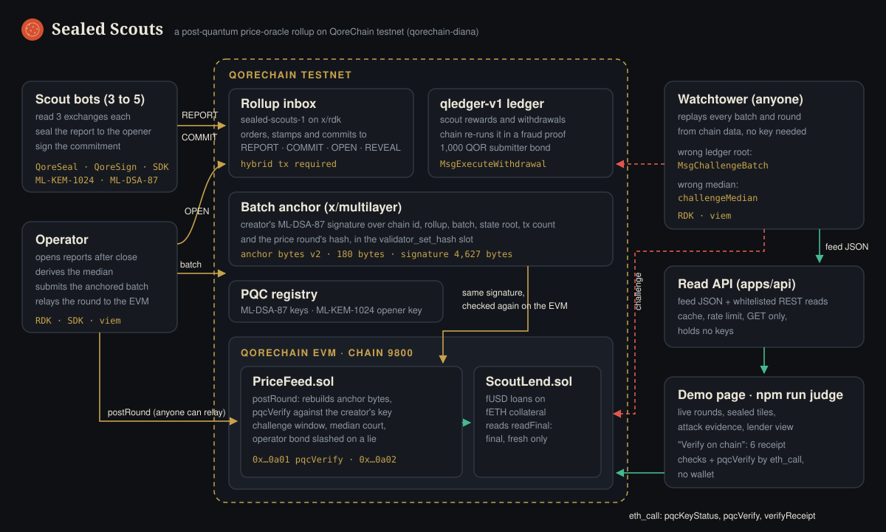

# Architecture

Sealed Scouts is a price-oracle rollup on the QoreChain testnet. Bonded bots ("scouts") post sealed price reports.
A rollup batch, signed with ML-DSA-87, carries the round's hash. An EVM contract checks that signature with the
chain's `pqcVerify` precompile before it accepts the price, and acts as a court if the median is wrong.

Parts that are not yet transactions on chain are design. [PROOF.md](../PROOF.md) lists what has evidence.
Message formats and the contract ABI are in [SPEC.md](SPEC.md).

## Why this shape

Three facts from our tests shaped the design.

1. **No custom state transition in an optimistic rollup.** A new optimistic rollup on QoreChain must use the fixed
   `qledger-v1` ledger and based sequencing. The chain re-runs only that ledger in a fraud proof.
2. **Any payload can go into the rollup inbox.** Posts that are not ledger transactions are accepted (up to 6,144
   bytes) and are no-ops for the ledger. The chain still orders them, stamps the height and the poster, and commits
   to them.
3. **An EVM contract can verify a real settlement anchor.** We checked live anchors from other rollups through
   `pqcVerify`, with the key read from `pqcKeyStatus`.

So reports live in the inbox, money lives in the ledger, the price round rides inside the anchor signature, and an
EVM court enforces the median.

## Components

| Component | Where it runs | Kits used | Job |
|---|---|---|---|
| Rollup `sealed-scouts-1` | QoreChain testnet, `x/rdk` | RDK 0.9.0 | Inbox (ordered data), ledger (rewards), batches, anchors, fraud proofs, withdrawals. |
| Scout bot (3 to 5) | Our server | SDK, QoreSeal, PQC, QoreSign, RDK | Read prices. Seal the report. Sign the commitment. Post both to the inbox. |
| Operator (creator, sequencer, opener and relayer in v1) | Our server | RDK, SDK, QoreSeal, viem | Open reports at round close. Pay rewards. Submit the batch with the anchor. Relay the round to the EVM feed. |
| Watchtower | Our server (anyone can run one) | RDK, viem | Replay ledger and rounds from chain data. Send fraud proofs. Publish the status feed. |
| `PriceFeed.sol` | QoreChain EVM (chain id 9800) | `pqcVerify`, `pqcKeyStatus` | Accept a round only with a valid anchor signature. Challenge window. Median court. Bonds and slashing. |
| `ScoutLend.sol` | QoreChain EVM | Fest test tokens | Demo lender: fETH collateral, fUSD loan. Reads only final, fresh prices. |
| Demo page and read API | Our server | RDK, viem | Live rounds, receipts, attack lab. |

## One round, step by step

Rounds are counted in main-chain blocks: `round = floor((height - GENESIS_HEIGHT) / ROUND_BLOCKS)`. Testnet blocks
take about 1.3 seconds. Default: `ROUND_BLOCKS = 300` (about 6.5 minutes), commit window 180 blocks, open window
40 blocks, reveal grace 40 blocks. The demo mode uses shorter rounds.

1. **Report (scout).** The scout reads 3 exchanges and takes its own median per feed. It builds
   `{round, salt, prices}` and posts two inbox entries:
   - `REPORT`: the plaintext sealed with QoreSeal (ML-KEM-1024) to the opener's registered key, about 1,850 bytes.
   - `COMMIT`: `SHA-256(round, scout, salt, prices)` plus the scout's ML-DSA-87 signature over it, about 4,750
     bytes.

   The chain refuses a transaction without the scout's ML-DSA-87 signature. Nobody can read the prices yet.
2. **Open (operator).** After the commit window, the operator decrypts all reports and posts one `OPEN` entry:
   scout, salt and prices for each report. Anyone can check each opened report against its commitment. The operator
   cannot change a report.
3. **Reveal fallback (scout).** If the operator skipped a valid report, that scout posts `REVEAL` itself in the grace
   window. The report counts. The skip is counted against the operator in public.
4. **Derive (everyone).** One pure function turns the round's inbox entries into the valid reports, the median per
   feed, the in-band list, the outliers and `reportsRoot`. The operator and the watchtower run the same code.
5. **Batch (operator).** The operator plans the next ledger batch with the RDK and submits it. The anchor signature
   covers the chain id, rollup, batch index, ledger root, transaction count and the round hash (in the
   `validator_set_hash` slot). If the chain refuses a hash in that slot, the fallback is a second signature over the
   round hash (see SPEC.md, change 14).
6. **Relay (anyone).** `PriceFeed.postRound(att, stateRoot, txCount, anchorSig)`. The contract rebuilds the anchor
   bytes, reads the creator's key from `pqcKeyStatus` and calls `pqcVerify`. If valid, the round is `Pending`.
7. **Challenge window (EVM, 120 seconds in the demo configuration).** The watchtower compares the pending round
   with its own result. If the median is wrong it calls `challengeMedian(round, leaves)`. The contract checks the
   leaves against `reportsRoot`, recomputes the median, slashes the operator bond (half to the challenger, half
   locked as burned) and stores the right price.
8. **Final.** With no challenge the round becomes `Final`. `ScoutLend` reads only `Final` prices that are fresh.
9. **Rewards and exit.** Each epoch the operator pays in-band scouts with ledger transfers. A scout posts a ledger
   withdrawal. After the batch finalises (1 hour on testnet), anyone executes the withdrawal with the RDK's Merkle
   proof.
10. **Ledger fraud.** If a bonded submitter posts a wrong ledger root, the watchtower sends the RDK fraud proof. The
    chain re-runs the batch and slashes the 1,000 QOR bond.

## On chain and off chain

| Thing | Where | Enforced by |
|---|---|---|
| Report order, time, poster | Main chain (rollup inbox) | Chain consensus. Hybrid signature rule (`hybrid_signature_mode: required`). |
| Report secrecy until close | Off chain (opener key) | ML-KEM-1024. Trust in one opener in v1 (limit L3). |
| Report cannot be changed after sealing | Inbox | Salted commitment and the scout's ML-DSA-87 signature. |
| Median | Derived off chain, posted to the EVM | EVM court: recompute from committed leaves, slash. |
| Ledger balances, rewards, withdrawals | Rollup ledger, settled on the main chain | Chain fraud proof (`MsgChallengeBatch`), 1,000 QOR bond. |
| Batch authenticity | Main chain anchor (`x/multilayer`) | Creator's ML-DSA-87 key. Re-checked on the EVM by `pqcVerify`. |
| Operator and scout bonds for price faults | `PriceFeed.sol` | The contract. Every privileged call needs an ML-DSA-87 signature. `msg.sender` is never an authority. |

## Read path

The watchtower writes `feed/status.json` and `feed/rounds/<n>.json`. The read API (`apps/api`) serves those files
and a whitelist of QoreChain REST reads. QoreChain REST sends no CORS headers, so a browser cannot call it
directly; the proxy is GET and HEAD only, rate limited and holds no keys.

The browser calls the public EVM endpoint directly for `pqcKeyStatus` and `pqcVerify`, because that endpoint allows
browser origins. That is how the demo page's Verify tab checks a receipt on chain with no help from our server.

## Real or simulated

Which parts are real testnet transactions, and which are simulated (for example the comparison with a classical
oracle on a local chain), is in the "Real or simulated" table in [LIMITS.md](../LIMITS.md). Known limits are
there too, and the attack table is in [THREAT_MODEL.md](../THREAT_MODEL.md).
